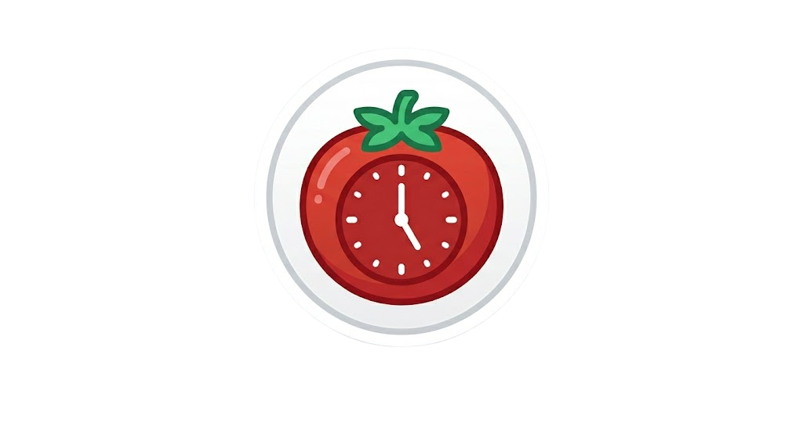
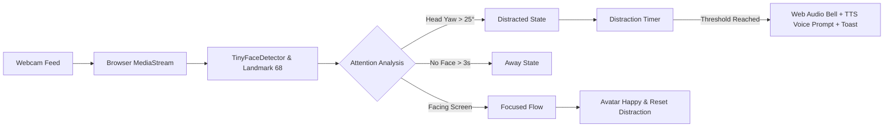

<div align="center">

  

  # Pomodorw
  ### The Intelligent, Privacy-First Focus Timer & Lo-Fi Companion

  [](LICENSE)
  [](https://developer.mozilla.org/en-US/docs/Web/JavaScript)
  [](https://developer.mozilla.org/en-US/docs/Web/Guide/HTML/HTML5)
  [](https://developer.mozilla.org/en-US/docs/Web/CSS)
  [](https://github.com/vladmandic/face-api)
  [](#-privacy--security-first)

  <p align="center">
    <b>A minimalist, warm-palette Pomodoro timer that uses browser-based computer vision to detect distractions in real time, gently nudge you back on track, and keep you in deep flow with integrated lo-fi beats.</b>
  </p>

  <p align="center">
    <a href="#-key-features">Key Features</a> •
    <a href="#-how-it-works">How It Works</a> •
    <a href="#-quick-start">Quick Start</a> •
    <a href="#-keyboard-shortcuts">Shortcuts</a> •
    <a href="#-privacy--security-first">Privacy Guarantee</a> •
    <a href="#-customization">Customization</a>
  </p>

</div>

---

## 📖 Overview

**Pomodorw** elevates the classic Pomodoro Technique with smart, private, client-side attention tracking. Traditional timers don't know whether you are coding or doom-scrolling on your phone. **Pomodorw** pairs an artisanal dark-mode interface with local face-detection AI to recognize when you glance away from your screen or leave your desk, playing customizable harmonic bells and spoken encouragements to protect your flow state.

Everything runs **100% locally in your browser**—no servers, no video uploads, no sign-ups, and zero tracking.

---

## ✨ Key Features

| Feature | Description |
| :--- | :--- |
| 🧠 **Real-Time Attention Tracking** | Employs `@vladmandic/face-api` (TinyFaceDetector, 68 Landmarks, Expressions) to track gaze angle, head yaw, and facial emotions without lag. |
| 🎭 **Expressive Reactive Avatar** | Dynamic SVG companion that visibly mirrors your focus state (`focused`, `going strong`, `distracted`, `away`, `welcome back`, `fun time`). |
| 🔔 **Synthesized Bell System** | Zero external audio asset dependencies for alerts. Procedurally synthesizes sound waves via the **Web Audio API** (Soft sine, Sharp square, or Wooden triangle tones with variable pitch). |
| 🗣️ **Spoken Voice Nudges** | Integrates browser **SpeechSynthesis (TTS)** to gently whisper or announce randomized motivational phrases when distraction is sustained. |
| 🎧 **Built-in Lo-Fi Music Player** | Curated playlist of 8 chill beats with integrated scrubber, smooth volume controls, and track auto-advancement. |
| 🍅 **Full Pomodoro Cycle** | 25-minute focus intervals, 5-minute short breaks, and 15-minute long breaks with automated 4-session cycle tracking. |
| ⚡ **Zero Backend Required** | Built with pure Vanilla HTML5, CSS3, and JavaScript. Completely portable and static-host ready. |
| 🔒 **100% Local & Private** | Video frames from your webcam are processed directly in client memory and immediately discarded. Never streamed or saved. |

---

## 🛠️ How It Works



### 1. Vision & Landmark Pipeline
When the camera toggle is activated:
* The app captures user video at `320x240` resolution using `navigator.mediaDevices.getUserMedia`.
* Facial landmarks (eyes, nose bridge) are measured to calculate lateral **head yaw angle**:
  $$\text{Yaw} \approx \left(\frac{\text{Nose}_x - \text{LeftEye}_x}{|\text{RightEye}_x - \text{LeftEye}_x|} - 0.5\right) \times 90^\circ$$
* If the head deviates past $\pm 25^\circ$, the timer flags a distraction event.
* If no face is detected for over 3 seconds, state transitions to `Away`.

### 2. Audio Synthesis Engine
Distraction chimes and cycle-completion bells are synthesized purely through client-side oscillators:
* **Soft Tone**: $440\text{ Hz}$ sine wave with harmonic overtone.
* **Sharp Bell**: $880\text{ Hz}$ square wave with high-order harmonics.
* **Wooden Tone**: $330\text{ Hz}$ triangle wave with earthy micro-frequencies.
* Exponential volume ramps emulate natural resonance decay without needing bulky audio files.

---

## 🚀 Quick Start

### Option A: Open Directly in Browser
Because Pomodorw is a standalone static web app, you can launch it with any modern web browser:

1. Clone or download this repository:
   ```bash
   git clone https://github.com/faizancodecom/pomodorow-clock.git
   cd pomodorow-clock
   ```
2. Start a lightweight local HTTP server (required for webcam permissions & audio policies):

   **Using Python 3:**
   ```bash
   python -m http.server 3000
   ```

   **Using Node.js (npx serve):**
   ```bash
   npx serve .
   ```

   **Using VS Code:**
   * Install the [Live Server extension](https://marketplace.visualstudio.com/items?itemName=ritwickdey.LiveServer)
   * Right-click `index.html` and click **"Open with Live Server"**.

3. Open your browser to `http://localhost:3000` (or the port indicated).

> [!IMPORTANT]
> Modern web browsers restrict webcam access (`getUserMedia`) to secure contexts (`https://` or `http://localhost`). Ensure you serve the site through `localhost` rather than opening `file:///` directly if you want to use the AI attention features.

---

## ⌨️ Keyboard Shortcuts

Speed up your workflow without taking your hands off the keyboard:

| Key | Action |
| :---: | :--- |
| <kbd>Space</kbd> | **Start** / **Pause** / **Resume** current timer session |
| <kbd>R</kbd> | **Reset** current session back to default interval |

---

## 🎶 Built-in Lo-Fi Beats

The included audio player comes pre-packaged with 8 relaxing, royalty-free study tracks located in `mustics/`:

1. `prettyjohn1` — *Lo-Fi Beats (533426)*
2. `mondamusic` — *Lo-Fi Girl Chill (512853)*
3. `prettyjohn1` — *Lo-Fi Music (533423)*
4. `mirostar` — *Lo-Fi Beats (531504)*
5. `mondamusic` — *Lo-Fi Music Chill (529558)*
6. `mirostar` — *Lo-Fi Music (531487)*
7. `solarflex` — *Lo-Fi Beats (541528)*
8. `the_mountain` — *Lo-Fi Music (496553)*

*Controls include Play/Pause, Next Track, Progress Bar scrubbing, and an expandable interactive volume slider with quick mute.*

---

## ⚙️ Customization & Settings

Click the **Gear Icon** (⚙️) in the top-right corner to open the Settings panel:

* **Alert Bell Profile**: Toggle between *Soft*, *Sharp*, or *Wooden* tones.
* **Bell Pitch**: Fine-tune frequency multiplier from $0.3\times$ to $1.5\times$.
* **Speech Synthesis Voice**: Select any installed system voice (female, male, natural, accented).
* **Speech Rate**: Adjust spoken prompt speed ($0.5\times$ to $1.8\times$).
* **Distraction Sensitivity**: Set the duration of inattention before an alert triggers ($2\text{s}$ to $12\text{s}$, default: $5\text{s}$).
* **Custom Motivational Phrases**: Add your own favorite quotes and reminders, one per line.
* **Feature Toggles**: Individually enable or disable the avatar, voice alerts, and bell chimes.

All preferences are automatically synchronized to your browser's `localStorage` (`pomodorw-settings`).

---

## 🔒 Privacy & Security First

Your personal workspace and camera privacy are non-negotiable:

* ✅ **100% Local Inference**: Face detection, facial landmark coordinates, and emotion classification are computed on your device's GPU/CPU via WebAssembly / WebGL.
* ✅ **No Video Storage or Transmission**: Camera frames are processed frame-by-frame and immediately overwritten. No video or still image is ever recorded or uploaded.
* ✅ **No User Accounts or Telemetry**: No tracking cookies, no Google Analytics, no third-party telemetry scripts.
* ✅ **Optional Camera Usage**: The Pomodoro clock works flawlessly as a standalone aesthetic timer even if camera permissions are never granted.

---

## 📂 Project Structure

```text
pomodorow-clock/
├── icon/
│   └── icon.png                  # Application logo & favicon
├── mustics/                      # Built-in chill lo-fi audio tracks
│   ├── mirostar-lofi-beats-531504.mp3
│   ├── mirostar-lofi-lofi-music-531487.mp3
│   ├── mondamusic-lofi-lofi-girl-lofi-chill-512853.mp3
│   ├── mondamusic-lofi-lofi-music-lofi-chill-529558.mp3
│   ├── prettyjohn1-lofi-beats-533426.mp3
│   ├── prettyjohn1-lofi-lofi-music-533423.mp3
│   ├── solarflex-lofi-beats-541528.mp3
│   └── the_mountain-lofi-lofi-music-496553.mp3
├── .gitattributes                # Line-ending normalization
├── .gitignore                    # Vercel & local build exclusions
├── index.html                    # Unified UI, styling, and application logic
└── README.md                     # Documentation & project guide
```

---

## 🎨 Design Philosophy & Color Palette

The interface was crafted to minimize eye fatigue during prolonged work sprints while evoking a cozy, study-hall atmosphere:

```css
--bg:            #1a1612;   /* Deep charcoal espresso */
--bg-card:       #221e18;   /* Warm card obsidian */
--accent:        #d4a353;   /* Vintage amber gold (Focus state) */
--break-color:   #7aa89f;   /* Sage seafoam (Break state) */
--distract:      #c05a4a;   /* Muted terracotta (Alert state) */
--text:          #e6dccf;   /* Warm parchment */
```

* **Typography**: [*Fraunces*](https://fonts.google.com/specimen/Fraunces) (editorial serif for numerals) paired with [*DM Sans*](https://fonts.google.com/specimen/DM+Sans) (clean geometric sans for UI text).
* **Atmosphere**: Subtle fractal noise texture overlay to break digital sterility.

---

## 🤝 Contributing

Contributions, feedback, and pull requests are warmly welcomed!

1. **Fork** the repository.
2. **Create a branch** for your feature:
   ```bash
   git checkout -b feature/amazing-feature
   ```
3. **Commit** your changes:
   ```bash
   git commit -m "Add amazing feature"
   ```
4. **Push** to your branch:
   ```bash
   git push origin feature/amazing-feature
   ```
5. **Open a Pull Request**.

---

## 📄 License

This project is open-source and released under the [MIT License](LICENSE). Feel free to use, modify, and distribute it for personal or commercial projects.

---

<div align="center">
  <sub>Crafted with passion for deep focus by <a href="https://github.com/faizancodecom">faizancodecom</a>. If you find this project helpful, consider starring ⭐ the repository!</sub>
</div>
